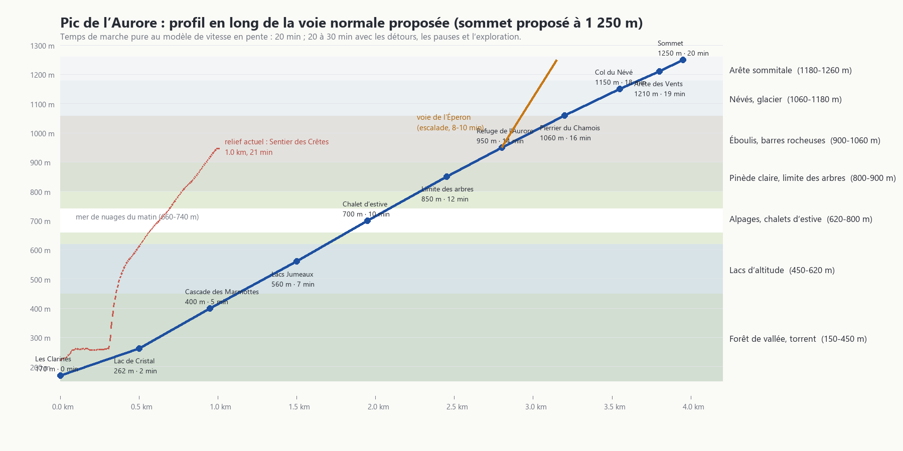
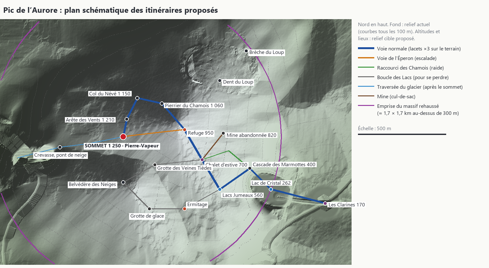

# Le Pic de l'Aurore et les Clarines : dossier de conception de la montagne

Dossier de l'agent Montagne (level design et gameplay de la montagne), à soumettre au client **avant** toute construction du relief.
C'est la tranche verticale de la montagne : un seul massif, conçu puis construit au niveau maximum, qui servira de modèle aux autres
(Fuji, Monts de Jade, Crêtes Blanches).
Il s'appuie sur `docs/BIBLE-MONDE.md` (Pays du Givre, §4 relief, §8 lieux), `src/world/world-map.ts` et les décisions de `docs/PASSATION.md` §2.
Chiffres et figures : `tools/montagne/analyse_massif.py`, qui lit le relief cuit actuel et qu'on peut relancer.

## 1. L'intention

> « De vraies montagnes, quoi. » Le client veut une **ascension** : une montée longue qui change de monde tous les cent mètres,
> qui fatigue un peu, où l'on a froid, où l'on a peur de tomber, où l'on se perd, et un sommet qui récompense.

La montagne doit raconter **le passage de l'été à l'hiver en une heure de jeu** : on part des prés fleuris et des clarines du village,
on traverse la forêt et le torrent, on longe des lacs turquoise, on monte aux alpages, on dépasse les derniers arbres tordus,
on grimpe dans les pierriers, on marche sur la neige, et l'on finit sur une arête au vent, au-dessus des nuages, d'où l'on voit toute l'île.

**Références d'ambiance (principes seulement, rien n'est copié)**
- Les grands open worlds de randonnée et d'escalade : la montagne **se lit de loin** (on voit le sommet dès le départ et on choisit sa voie),
  l'**endurance** transforme une paroi en petit problème à résoudre, le **froid** se gère par la tenue et le feu, et un **point haut** révèle
  de nouveaux lieux à visiter. On reprend ces principes, pas leurs règles exactes, leurs interfaces ni leurs lieux.
- Les jeux de marche contemplative : le **silence** et le vent en altitude, la lumière qui change, la récompense est la vue.
- La vraie montagne des Alpes : la vallée glaciaire en U avec son verrou et sa cascade, les lacs d'altitude au pied des pierriers, les alpages et
  leurs chalets d'estive, la limite des arbres avec ses arolles tordus, les cairns qui balisent le brouillard, le refuge au toit rouge,
  la croix et le livre d'or au sommet, la mer de nuages du matin.

**Ce qu'on évite** : un cône lisse qu'on gravit en ligne droite ; une montée sans étapes ; une difficulté qui punit (mort, perte d'objets,
recommencer de loin) ; des murs invisibles ; des images violentes.

## 2. L'échelle

### 2.1 Ce qui existe aujourd'hui (mesuré sur le relief cuit)
| Mesure | Valeur |
| --- | --- |
| Sommet du Pic de l'Aurore | **946 m** en (-2294, 444) ; Clarines 165 m ; Lac de Cristal 257 m |
| Distance horizontale Clarines → sommet | **0,96 km** pour 780 m de dénivelé, soit une pente moyenne de **39°** |
| Pentes autour du sommet (rayon 300 m / 700 m / 1,2 km) | médiane 39° / 40° / 34° ; **91 % / 88 % / 59 % au-dessus de 33°** |
| Sentier des Crêtes (`sentier-aurore`) | 1,0 km, D+ 742 m, pente moyenne 36°, **54 % du tracé au-dessus de 33°**, ressauts à 80° |
| Modelé (écart à la surface lissée sur 60 m) | médiane **0,9 m** : le versant est lisse à l'échelle d'un sentier |
| Plafond du codage des hauteurs (16 bits) | **988 m** : aucun relief ne peut dépasser cette altitude sans changer le codage |

Le constat est double. Aujourd'hui on monte en ligne droite parce que la vitesse ignore la pente (partie B le corrige). Mais avec des règles
de pente réalistes, **le Pic actuel serait presque partout infranchissable à pied** : c'est un cône de 1 km de rayon à 39°, sans vallons,
sans replats ni crêtes praticables. Le massif doit donc être **refait par le Terrain**, quelle que soit l'altitude choisie.

### 2.2 Durée visée et vitesse en pente
Cible : **20 à 30 minutes** des Clarines au sommet par la voie normale, pour une enfant qui explore (pauses, détours, regard sur le paysage),
soit **15 à 20 minutes de marche pure**.

Vitesse de marche selon la pente dans le sens de la marche (implémentée dans `src/gameplay/mountain.ts`, partie B) :

| Pente en montée | Vitesse de marche | Vitesse verticale |
| --- | --- | --- |
| 0 à 8° | 4,2 m/s (100 %) | — |
| 15° | 3,4 m/s (80 %) | 0,90 m/s |
| 20° | 2,7 m/s (65 %) | 0,99 m/s |
| 25° | 2,1 m/s (50 %) | 0,98 m/s |
| 30° | 1,6 m/s (37 %) | 0,90 m/s |
| 35° | 1,0 m/s (24 %) | 0,71 m/s |
| 40° | 0,6 m/s (14 %) | 0,49 m/s |
| > 41° (pente du sol) | n'avance plus, glisse | — |

En descente, la marche accélère jusqu'à +12 % vers 15° ; au-delà de 41° (32° sur la neige), le capybara **glisse** (un peu dirigeable).
La course à quatre pattes suit la même courbe, coûte de l'endurance, et devient impossible au-delà de 30°.

**Compression du temps assumée** : une randonneuse entraînée monte 400 à 600 m par heure ; le capybara monte au mieux **1 m par seconde**
(3 600 m/h), soit environ **7 fois plus vite**. C'est le même ordre de compression que les distances du monde (1 km ≈ 4 min de marche).
Le meilleur rendement vertical est entre 18 et 28° : ce sont les **sentiers en lacets**, ce qui donne envie de les suivre plutôt que de
monter tout droit dans le pierrier à 35°.

À 0,95 m/s de moyenne verticale, 15 à 20 minutes de marche pure correspondent à **850 à 1 150 m de dénivelé** depuis les Clarines (170 m),
donc un sommet entre **1 020 et 1 320 m**.

### 2.3 Faut-il rehausser le Pic ? Trois options
Les hauteurs de la bible ont été validées par le client : une hausse est une **proposition**, pas une décision.

| | A. Garder 950 m | **B. 1 250 m (recommandé)** | C. 1 550 m | D. 1 800 à 2 200 m |
| --- | --- | --- | --- | --- |
| Dénivelé depuis les Clarines | 780 m | **1 080 m** | 1 380 m | 1 630 à 2 030 m |
| Marche pure (modèle) / avec exploration | 14 min / 18-24 min | **20 min / 25-30 min** | 31 min / 40-45 min | 40-55 min / plus d'une heure |
| Voie normale (longueur réelle avec lacets) | 2,9 km | **4,0 km** | 7,0 km | 9 à 11 km |
| Emprise du massif au-dessus de 300 m | 1,4 × 1,6 km (comme aujourd'hui, mais modelée) | **≈ 1,7 × 1,7 km**, sommet déplacé de 300 m vers l'ouest | ≈ 2,3 × 2,3 km | 3 à 4 km : la moitié ouest de l'île |
| Sommet vu de la place de Capyville | 22° au-dessus de l'horizon, dépasse l'épaule de Kuma de 3 à 6° | **25°**, dépasse Kuma de 6 à 9° | 30° | 33 à 38° : domine tout le ciel de Capyville |
| Régions voisines | rien ne bouge | Glacier plus court et plus raide vers le fjord ; Mont des Neiges 1 000 m, Dent du Loup 820 m ; côte des Fjords et Brèche du Loup inchangées | Côte des Fjords réduite à une falaise ; Brèche du Loup à 650 m ; Col des Aurores repoussé | Londres, Clarines et Pôle à redessiner ; l'île n'a plus de place pour des pentes praticables |
| Coût | relief à refaire | relief à refaire + **codage des hauteurs** (pas de 3,2 cm au lieu de 1,6 cm) + bible et `world-map.ts` | idem B + carte du Givre à reprendre | refonte de la carte du monde |

Pourquoi pas 2 000 m ? Parce que l'île fait 7,4 km de large. Une montagne praticable a des versants de 25 à 30° en moyenne entre la vallée et
le sommet (les vallées pénètrent le massif, puis une pyramide plus raide) : 2 000 m de haut demandent un rayon de base de 3,5 à 4 km, soit
la moitié de l'île. À hauteur égale, ce qui fait « vraie montagne » ne tient pas au chiffre mais à **la durée de la montée, au changement
d'étage tous les 150 m, au vide sous les pieds et à la mer de nuages**. Le relief actuel le montre : 950 m de cône lisse ne donnent aucune de ces sensations.

**Recommandation : option B, 1 250 m**, sommet déplacé de (-2300, 450) à **(-2600, 520)**, au-dessus du glacier. Elle tient la durée visée,
ne touche à aucune région ni à aucune ligne de vue validée (le Pic reste au cap 259° depuis la place, un peu plus haut au-dessus de Kuma),
et laisse la place à de vrais vallons. Si le client préfère ne rien changer, l'option A fonctionne aussi : la montée est alors plus courte
(18 à 24 minutes), et l'on compense par la longueur des lacets et les détours.

## 3. Les étages, de la vallée au sommet (option B)
Altitudes de l'option B. Avec l'option A, on multiplie les altitudes au-dessus de 300 m par 0,75 environ.

| Étage | Altitude | On voit | On entend | Faune | Flore | Météo, froid ressenti |
| --- | --- | --- | --- | --- | --- | --- |
| **1. Forêt de vallée et torrent** | 150-450 m | épicéas élancés, mousse, rayons dans les troncs, le verrou et la **cascade des Clarines** (50 m), blocs moussus | torrent, cloches des vaches en contrebas, pics | écureuils roux, cincle plongeur dans le torrent, chevreuils | épicéas, sapins, hêtres en bas, myrtilles, fougères | doux, 16-20 °C ressentis, brume du matin dans le fond |
| **2. Lacs d'altitude** | 450-620 m | **Lac de Cristal** (262 m) puis **Lacs Jumeaux** turquoise, reflets du Pic, pierriers qui plongent dans l'eau | clapotis, grenouilles, vent qui ride l'eau | truites, tritons, libellules | linaigrettes, joncs, rhododendrons | frais, 12-15 °C ; vent sur l'eau |
| **3. Alpages et chalets d'estive** | 620-800 m | prés en pente fleuris, **chalet d'estive** et sa fontaine, murets, troupeau, cairns sur les bosses | **clarines**, sifflets des marmottes, ruisseaux | **marmottes** (sentinelles qui sifflent), vaches, papillons, chocards | gentianes, arnica, edelweiss en haut, mélèzes isolés | grand beau, cumulus qui se forment l'après-midi, 10-12 °C |
| **4. Pinède claire et limite des arbres** | 800-900 m | derniers **arolles tordus** par le vent, troncs blanchis, bois mort, premières plaques de neige à l'ombre | vent dans les aiguilles, cassenoix | **cassenoix**, lièvre variable, **chamois** à la lisière | arolles, pins à crochets, genévriers nains | le vent se lève, 6-9 °C ressentis ; **la jauge de chaleur commence à baisser** |
| **5. Éboulis et barres rocheuses** | 900-1 060 m | **pierriers** gris, barres de roche grimpables (marquées de lichen orange), le refuge au toit rouge, le vide sous la vallée | cailloux qui roulent, **sifflement du vent**, chute de pierres lointaine | **bouquetins** sur les vires, **chamois**, **aigle royal** qui tourne en dessous de soi | coussins de fleurs (silène acaule), lichens | 2-5 °C ressentis ; rafales ; nuages qui passent à hauteur des yeux |
| **6. Névés et glacier** | 1 060-1 180 m | **névés** où l'on glisse, langue du **Glacier de l'Aurore** bleue et crevassée, **pont de neige**, séracs | craquements de la glace, eau de fonte sous la neige | **lagopèdes** blancs, traces d'hermine, chocards | presque rien : quelques mousses | -2 à 2 °C ressentis ; **brouillard** possible ; souffle visible |
| **7. Arête sommitale exposée** | 1 180-1 250 m | arête de roche et de neige large de 2 à 5 m, **vide des deux côtés**, mer de nuages, toute l'île | **vent fort, puis le silence** au sommet abrité | aigle au-dessous de soi, chocards qui jouent dans le vent | aucune | -8 à -4 °C ressentis, de nuit -15 °C : **le manteau d'hiver** rend le froid supportable |

## 4. Les itinéraires

| Voie | Tracé | Longueur réelle | D+ | Temps de marche | Caractère |
| --- | --- | --- | --- | --- | --- |
| **Voie normale** | Clarines → Lac de Cristal → Cascade des Marmottes → Lacs Jumeaux → Chalet d'estive → Refuge (950 m) → Pierrier du Chamois → Col du Névé (1 150 m) → Arête des Vents → sommet | 4,0 km (lacets ×3 sur le terrain) | 1 080 m | **20 min** (25-30 avec l'exploration) | sentier de pierre, cairns tous les 60-80 m, marches de rondins au-delà de 18 %, jamais au-dessus de 30° ; câble à l'arête |
| **Voie de l'Éperon** | Refuge → éperon sud-est en escalade → sommet | 0,4 km | 300 m | ≈ 6 min | trois barres de roche grimpable de 15 à 25 m séparées par des vires de repos ; demande de gérer l'endurance ; vue plongeante sur le glacier |
| **Raccourci des Chamois** | Cascade → sentier de bêtes raide → Chalet d'estive | 0,5 km | 300 m | ≈ 4 min | pente à 28-32°, gagne 3 minutes mais fatigue ; on y croise les chamois |
| **Boucle des Lacs** | Lacs Jumeaux → Ermitage → Grotte de glace → Belvédère des Neiges → Grotte des Veines Tièdes → Chalet | 2,2 km | 250 m | 10 min | **la route pour se perdre** : vallon sans sentier, brouillard le matin, cairns épars, lacs cachés |
| **Traversée du glacier** | Sommet → crevasse et pont de neige → front du glacier → fjord | 1,8 km | -1 250 m | 8 min | descente « récompense » : glissades sur les névés, pont de neige, arrivée au Belvédère du Glacier |
| **Mine (cul-de-sac)** | Chalet → mine abandonnée | 0,3 km | 120 m | 2 min | galerie, wagonnet, vue sur la vallée ; abri contre le froid |

Règles de tracé pour le Terrain et les Routes : le sentier suit les **courbes de niveau en lacets** (pente du sentier 15-20 %, terrain autour
jusqu'à 33°), un **replat tous les 60-100 m de dénivelé** (halte, banc, cairn, point de vue), et chaque changement d'étage se fait par un
**seuil** (verrou, ressaut, col) qui cache le pays suivant puis le révèle. Le sentier ne passe jamais dans une zone à plus de 41° : là, c'est
l'escalade ou rien. Le profil en long est en tête de ce dossier.

## 5. Les lieux à découvrir
| Lieu | Altitude | Ce qu'on y trouve | Lien avec le lore |
| --- | --- | --- | --- |
| **Cascade des Clarines** et son verrou | 205-255 m | ruban de 50 m, vasque, **grotte derrière le rideau** | règle de la bible : toute cascade de plus de 10 m cache quelque chose |
| **Lac de Cristal** | 262 m | ponton, truites, eau transparente | balade « Le Lac de Cristal » de la bible |
| **Cascade des Marmottes** | 400 m | petite cascade en escalier, colonie de marmottes | — |
| **Lacs Jumeaux** | 560 m | deux lacs reliés par un gué de pierres, reflets du sommet | lieu de pique-nique, premier point de vue sur Capyville |
| **Chalet d'estive** | 700 m | bergère, fromage, lait chaud, **feu** (chaleur) | quête du **manteau d'hiver** (phase gameplay) |
| **Mine abandonnée** | 820 m | galerie de 60 m, wagonnet, cristaux, abri du vent | les mineurs ont trouvé une **Veine Tiède** : l'air y est tiède |
| **Ermitage** | 640 m | cabane d'un vieil ermite qui note le temps qu'il fait | il raconte que le Voyageur du Grand Froid est monté au sommet « pour voir les six côtes à la fois » |
| **Grotte des Veines Tièdes** | 700 m | grotte où une source chaude affleure, vapeur, lumière bleue | **fragment de fresque des Six Voyageurs** ; point chaud (remonte la jauge) |
| **Grotte de glace** | 760 m | couloirs de glace translucide, lumière bleue, stalactites | Squishy « pailleté des neiges » caché au fond |
| **Belvédère des Neiges** | 800 m | rocher en surplomb, longue-vue | vue sur le Mont des Neiges et la Baie Gelée |
| **Refuge de l'Aurore** | 950 m | gardienne, soupe chaude, **feu**, lits, livre des courses | point sûr et point chaud ; dernier arrêt avant le sommet |
| **Cairns** | partout au-dessus de 600 m | tous les 60-80 m sur la voie normale, plus espacés ailleurs | les Voyageurs ont laissé une pierre gravée dans certains (petite collection) |
| **Pierrier du Chamois** | 1 060 m | bouquetins sur les vires, blocs instables qui roulent (sans danger) | — |
| **Crevasse et pont de neige** | 1 100 m | pont de neige à traverser lentement, crevasse bleue qu'on peut regarder (elle n'avale personne : bord en pente douce et retour sûr) | — |
| **Col du Névé** | 1 150 m | grand névé, glissade possible vers le glacier, vent | — |
| **Sommet** | 1 250 m | croix de bois, livre d'or, **Pierre-Vapeur de l'Aurore**, aurore la nuit | voir ci-dessous |

**La Pierre-Vapeur du sommet.** On ajoute une seizième borne, la **Pierre-Vapeur de l'Aurore**, au sommet (la bible en compte quinze ;
à valider, question 3). Le voyage rapide n'est possible que vers une borne réveillée à pied (décision validée) : réveiller celle du sommet
**à pied** est donc la vraie récompense de l'ascension, puisqu'elle permet ensuite de **revenir au sommet en un instant** pour voir l'aurore,
la mer de nuages ou partir en glissade par le glacier. Dans le lore, c'est la borne la plus haute des Voyageurs : de là, le Voyageur du Grand Froid
voyait les six côtes, et sa vapeur, visible de toute l'île quand elle est réveillée, **indique aux autres Pierres-Vapeur où se trouve le cœur des Veines**.
Effet de jeu proposé : une fois réveillée, les Pierres-Vapeur encore endormies de l'île **apparaissent sur la carte** (pas leur chemin).

## 6. Les mécaniques de montagne (adaptées à 9-12 ans)
Principe : **un vrai enjeu, jamais de punition**. On ne meurt pas, on ne perd rien de ce qu'on a gagné, on ne recommence jamais de loin.

| Mécanique | Règle | Ce que voit l'enfant | Dans la partie B |
| --- | --- | --- | --- |
| **Vitesse selon la pente** | courbe du §2.2 ; en descente +12 % jusqu'à 15° | le capybara ralentit, se penche vers l'avant, souffle | oui |
| **Pente infranchissable** | au-delà de 41° hors roche grimpable, on n'avance plus en montée et l'on glisse vers le bas ; **sur un chemin tracé ou à la tête d'un pont**, les ressauts raides se franchissent toujours, lentement (marches et prises taillées, câbles) | glissade sur le derrière, petite traînée de poussière ou de neige | oui |
| **Glissade en descente** | au-delà de 41°, glissade un peu dirigeable ; sur la neige dès 32° ; une glissade le long d'une paroi de plus de 55° compte comme une chute | assis sur le derrière, gerbe de neige ou de poussière ; c'est aussi un jeu (névés) | oui |
| **Endurance** | 100 points ; la course coûte 9/s (plus en montée), l'escalade 6,5/s ; recharge 28/s au repos, 14/s en marchant, 0,9 s après l’effort | **anneau discret** près du capybara, visible seulement quand il n'est pas plein ; rouge quand il est presque vide | oui |
| **Escalade** | sur la roche au-dessus de 45° (`surfaceAt` roche) : on s’accroche en avançant vers la paroi, 0,85 m/s de montée verticale ; endurance vide → il glisse le long de la paroi jusqu'au replat | pose à plat ventre contre la paroi, pattes qui alternent | oui (provisoire : toute roche raide, pas de prises marquées) |
| **Chute** | moins de 4 m : rien ; 4 à 14 m : **roulade**, puis se relève, 1 à 3 demi-cœurs en moins (jamais le dernier) ; plus de 14 m : **fondu doux** et retour au dernier point sûr, 2 demi-cœurs en moins | roulé-boulé comique, étoiles, « Ouille ! » ; jamais de blessure montrée | oui |
| **Froid** (décision du client) | jauge de chaleur 0-100 ; baisse au-dessus de 650 m (de plus en plus vite avec l'altitude) et la nuit ; remonte près d'un feu, d'une lanterne, d'une vapeur des Veines Tièdes ou au refuge. **Hors mode survie, le froid ne fait aucun dégât et ne force jamais à redescendre** : sous 25, l'endurance revient jusqu'à 40 % moins vite, c'est tout. **Mode survie** (option à venir) : le froid y coûte un demi-cœur toutes les 20 s à jauge vide (point d'entrée `Player.survival` / `onColdHurt`) | **givre** au bord de l'écran, **souffle visible**, le capybara frissonne | oui |
| **Manteau d'hiver** (décision du client) | objet de l'inventaire : **équipé, le froid disparaît** jusqu'au sommet ; débloqué plus tard par une quête (phase gameplay, par exemple au chalet d'estive). Le bonnet arrête déjà 25 % du froid | manteau visible sur le capybara ; icône 🧥 dans la jauge | crochet prêt (`Player.winterCoat`, drapeau de test `?manteau`) ; objet, modèle et quête à faire |
| **Vent** | rafales sur l'arête et au col : poussée latérale douce, froid plus rapide ; le capybara se met à quatre pattes s'il s'arrête | herbe et neige soufflées, son du vent | à faire (avec Rendu et Son) |
| **Brouillard** | certains matins au-dessus de 600 m et dans la Boucle des Lacs : vue à 40-60 m | cairns et **bruit du torrent** pour s'orienter | à faire (Rendu) |
| **Se perdre sans frustration** | cairns sur la voie normale ; le sommet et sa vapeur visibles de partout dès qu'on sort du brouillard ; la boussole de la mini-carte indique toujours le refuge et le sommet ; un sentier se retrouve toujours en descendant (tous les vallons ramènent aux lacs) | — | à faire (Gameplay) |
| **Véhicules** | voiture et motoneige perdent de la traction au-delà de 25-30° et reculent au-delà ; la route s'arrête aux Clarines, la piste de la motoneige au chalet d'estive | les roues patinent, gerbes de neige | à faire (Conduite) |

## 7. Ce que ressent le joueur au sommet
- **La mer de nuages** à 660-740 m le matin (jusqu'à 10 h) : les vallées disparaissent, les sommets voisins (Mont des Neiges, Dent du Loup)
  sortent comme des îles. Capyville n'est plus qu'une colonne de vapeur qui perce les nuages au loin.
- **Toute l'île** quand les nuages se lèvent : les trois mers, le Fuji, la Chute des Mille Voiles, les villes miniatures, le glacier sous les pieds.
- **Le vent** sur l'arête, puis **le silence** au sommet abrité par la croix : on n'entend plus que la vapeur de la Pierre-Vapeur et le livre d'or qui bat.
- **Le froid** : le souffle se voit, le givre gagne le bord de l'écran, on cherche la chaleur de la Pierre-Vapeur réveillée.
- **La nuit** : l'aurore verte et violette danse au-dessus de la Baie Gelée, les fenêtres des villes et les Pierres-Vapeur réveillées brillent
  comme des étoiles posées sur l'île.
- **La fierté** : le livre d'or où l'on écrit son nom, la photo du sommet pour l'album, la borne qui ramènera ici en un instant.

## 8. Les chantiers, par spécialité et dans l'ordre
| Spécialité | Chantiers (dans l'ordre) | Coût estimé |
| --- | --- | --- |
| **Terrain** | 1. Codage des hauteurs à 3,2 cm (plafond 2 000 m) si l'option B ou C est retenue. 2. Massif refait par formes dirigées : vallée en U et verrou, gradins des lacs, cirque des alpages, crêtes et éperons, pyramide sommitale, glacier. 3. Érosion et éboulis, replats tous les 25-45 m. 4. Barres rocheuses grimpables marquées dans la carte dérivée (canal roche). 5. Contrôle : la voie normale reste sous 30°, chaque barre a un contournement. | élevé : 2 à 3 sessions |
| **Végétation** | étagement par altitude (épicéas → mélèzes et arolles → limite des arbres à 850-900 m), arbres tordus et bois mort à la limite, fleurs d'alpage, coussins de fleurs et lichens | moyen |
| **Eau** | Lac de Cristal et Lacs Jumeaux (eau turquoise), cascade des Clarines et cascade des Marmottes, ruisseaux de fonte, glacier (bleu, crevasses) | moyen |
| **Rendu** | neige et névés, mer de nuages et brouillard d'altitude, givre de l'écran, aurore, perspective aérienne au sommet | élevé |
| **Modélisation** | refuge, chalet d'estive, ermitage, mine et wagonnet, croix et livre d'or, cairns, câbles, Pierre-Vapeur du sommet, pont de neige ; rochers photoscannés (déjà chez le Terrain v2) | moyen |
| **Gameplay** | mécaniques de la partie B (en cours sur `wip/montagne`) ; vent ; orientation (cairns, boussole) ; quête du manteau d'hiver ; Pierre-Vapeur du sommet et voyage rapide ; faune (marmottes, chamois, bouquetins, aigle, lagopèdes) ; véhicules en pente | moyen, en cours |
| **Son** | étagement sonore : torrent → clarines → marmottes → vent → silence ; craquements du glacier ; souffle du capybara | faible à moyen |

## 9. Décisions du client (2026-11-22)
1. **Hauteur du Pic : validée à 1 250 m**, sommet déplacé en **(-2600, 520)**. La montée dure 25 à 30 minutes ; aucune région ni ligne de vue ne change.
   À reporter par le lead dans `world-map.ts` et la bible ; le Terrain change le codage des hauteurs (plafond actuel 988 m).
2. **Froid : la bergère est refusée.** Le client la remplace par un **objet « manteau d'hiver »** qui protège du froid, et ne veut **aucun dégât lié
   au froid hors du mode survie** (option, seul mode avec faim, soif et vie). Hors survie, le froid reste une sensation (jauge, givre, souffle,
   frissons, endurance un peu plus lente à revenir), sans jamais bloquer ni ramener en arrière. Le manteau d'hiver fait disparaître le froid.
3. **Pierre-Vapeur du sommet : validée.** Seizième borne, réveillée seulement à pied, voyage rapide vers le sommet, bornes endormies montrées sur la carte.
4. **Chutes douces : validées.** Roulade et un à trois demi-cœurs en moins, jamais de « Ouf ! » à cause d'une chute ; au-delà de 14 m, fondu doux et
   retour au dernier point sûr.
5. **Escalade seulement sur les barres marquées : validée.** Le Terrain marque les barres grimpables (lichen orange, prises visibles) dans la carte
   dérivée ; en attendant, toute roche au-dessus de 45° est grimpable (`mountainTerrain.rock`).
